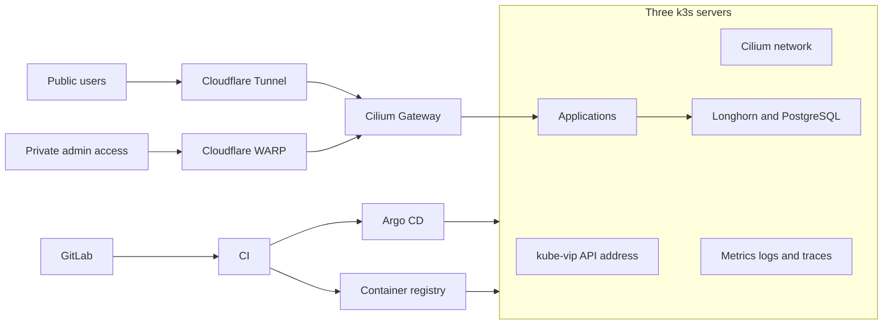

# Kubernetes homelab

I designed this k3s cluster for three x86-64 PCs and validated it temporarily on AWS
after the PCs became unavailable. The AWS lab is now destroyed; its real screenshots
and test results remain here. Git holds node setup, cluster resources, policy, and
delivery. The target design uses Cloudflare Tunnel and WARP without inbound router ports.

[Editable Kubernetes homelab diagrams](docs/diagrams/README.md)



## What runs on it

- Cilium, Hubble, Argo CD, and Argo Rollouts
- Longhorn, CloudNativePG, and Velero
- OpenBao and External Secrets
- Prometheus, Grafana, Loki, Alloy, Tempo, and OpenTelemetry
- Kyverno and Trivy Operator
- Homelab Sentinel, Keycloak, and Vaultwarden
- Homepage and Uptime Kuma
- Chaos Mesh

## Layout

```text
apps/           application source and Kubernetes resources
clusters/       Argo CD entry points for the homelab cluster
config/         values that belong to this installation
infra/          Ansible node setup and OpenTofu cloud resources
observability/  metrics, logs, traces, dashboards, and alerts
platform/       shared cluster services
policies/       admission and supply-chain policy
scripts/        local validation and guarded operations
docs/           design decisions, runbooks, and recovery drills
```

## Using it

Run `make help` for the available checks and guarded operations. Before the first
bring-up, work through [the setup list](docs/setup.md), then follow the
[bring-up checklist](docs/bring-up-checklist.md).

## State

The repository passes offline validation. AWS results and remaining physical-PC
checks are recorded in [the status table](docs/status.md).

[Evidence](docs/evidence.md) · [Architecture](docs/architecture.md) · [ADRs](docs/adr/README.md) · [Runbooks](docs/runbooks/README.md) · [DR drills](docs/dr/README.md)

Licensed under the [MIT License](LICENSE).
