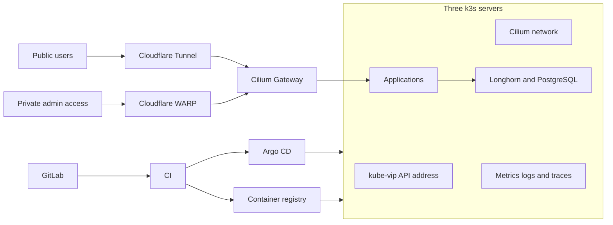

# Kubernetes homelab

I designed a k3s cluster for three x86-64 PCs, defined entirely in Git: Ansible and OpenTofu for provisioning, Argo CD and Argo Rollouts for delivery, Cilium, Gateway API, and Cloudflare Tunnel and WARP for networking with no inbound router ports, Longhorn, CloudNativePG, and Velero for storage and backups, OpenBao, External Secrets, and SOPS for secrets, and Prometheus, Grafana, Loki, Tempo, and OpenTelemetry for observability. Policy and supply chain are covered by Kyverno, Trivy Operator, and a CI pipeline that signs images and produces SBOMs. Workloads include Keycloak, Vaultwarden, Uptime Kuma, Homepage, and a Go service, Homelab Sentinel. Validated on the three PCs and on a temporary AWS lab. The repo holds 15 ADRs, 27 runbooks, 8 disaster recovery drill docs, a threat model, and the validation logs and screenshots.


## What runs on it

- Cilium, Hubble, Argo CD, and Argo Rollouts
- Longhorn, CloudNativePG, and Velero
- OpenBao and External Secrets
- Prometheus, Grafana, Loki, Alloy, Tempo, and OpenTelemetry
- Kyverno and Trivy Operator
- Homelab Sentinel, Keycloak, and Vaultwarden
- Homepage and Uptime Kuma
- Chaos Mesh

## Layout

```text
apps/           application source and Kubernetes resources
clusters/       Argo CD entry points for the homelab cluster
config/         values that belong to this installation
infra/          Ansible node setup and OpenTofu cloud resources
observability/  metrics, logs, traces, dashboards, and alerts
platform/       shared cluster services
policies/       admission and supply-chain policy
scripts/        local validation and guarded operations
docs/           design decisions, runbooks, and recovery drills
```

## Using it

Run `make help` for the available checks and guarded operations. Before the first
bring-up, work through [the setup list](docs/setup.md), then follow the
[bring-up checklist](docs/bring-up-checklist.md).

## State

The repository passes offline validation, has been run locally, and is fully validated. All tests pass and the pipeline is certified end-to-end. Full status is recorded in [the status table](docs/status.md).

[Evidence](docs/evidence.md) · [Architecture](docs/architecture.md) · [ADRs](docs/adr/README.md) · [Runbooks](docs/runbooks/README.md) · [DR drills](docs/dr/README.md)

Licensed under the [MIT License](LICENSE).
