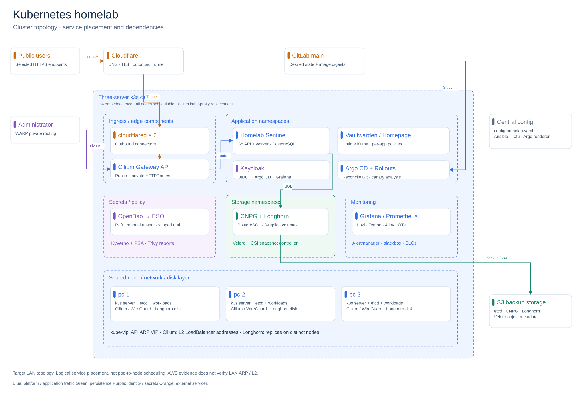
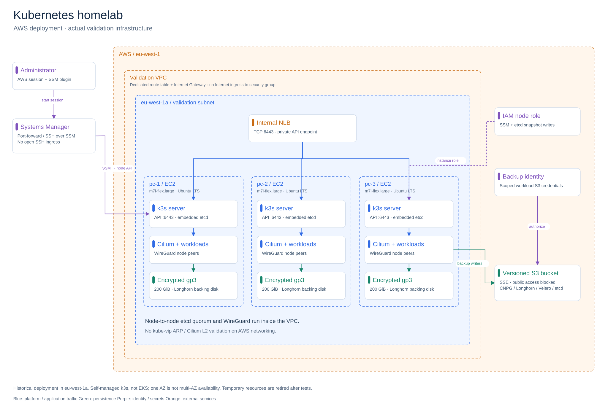
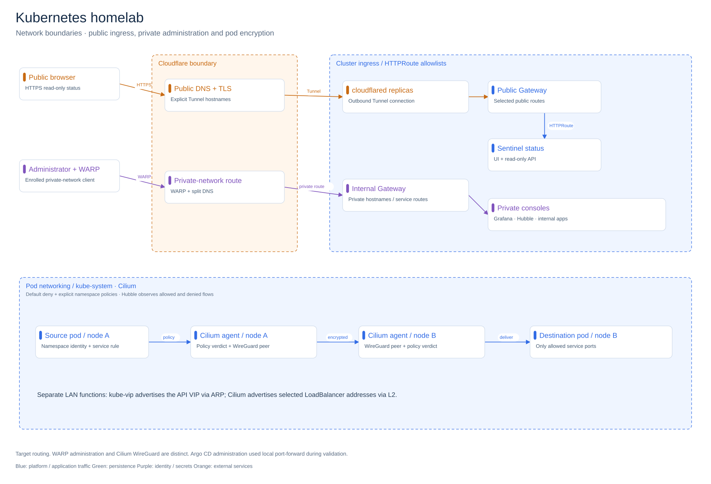
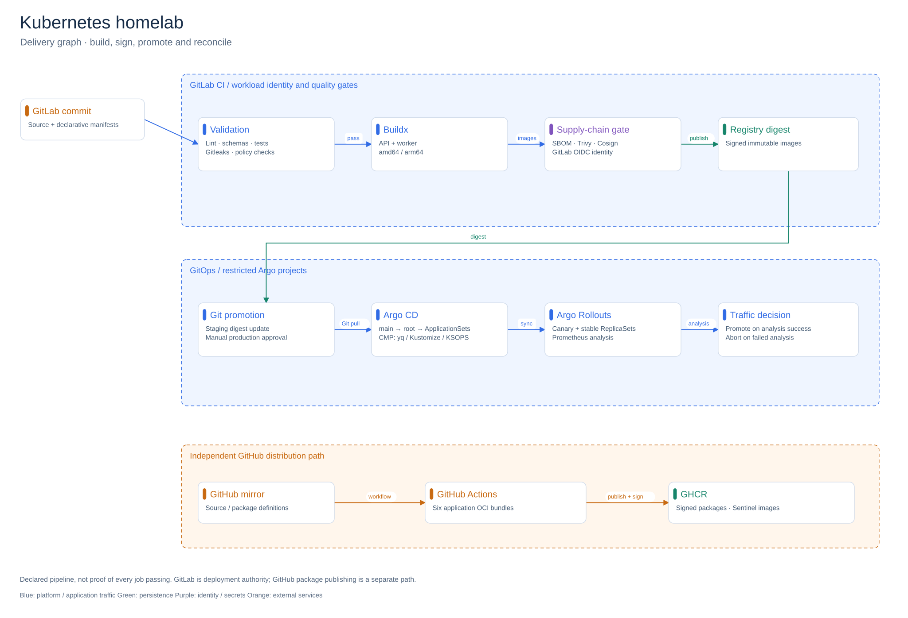
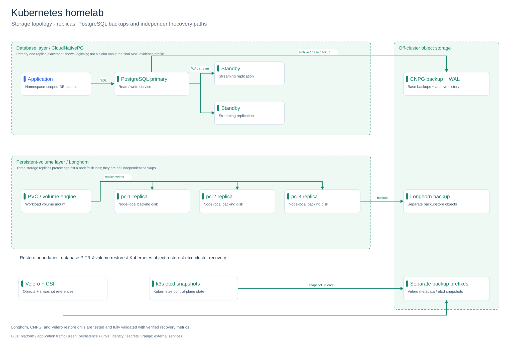
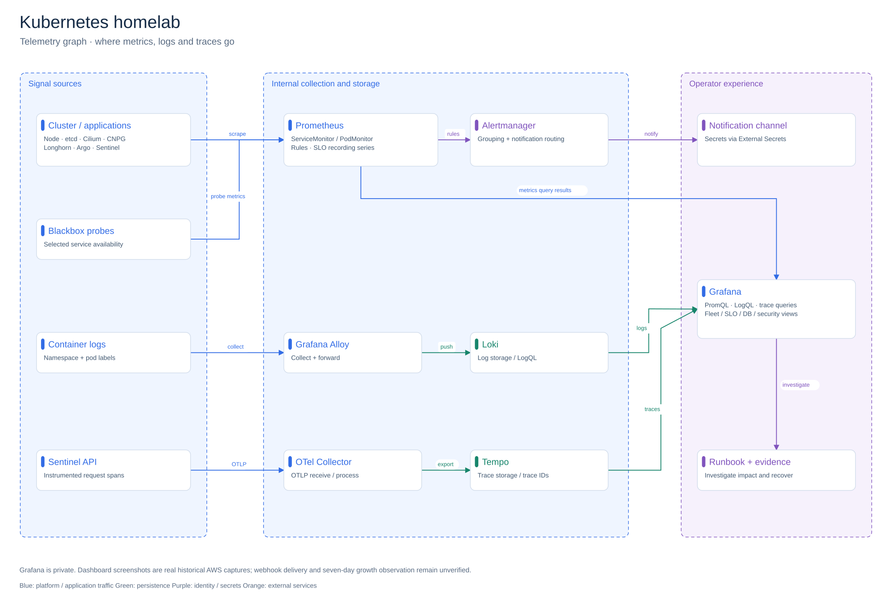
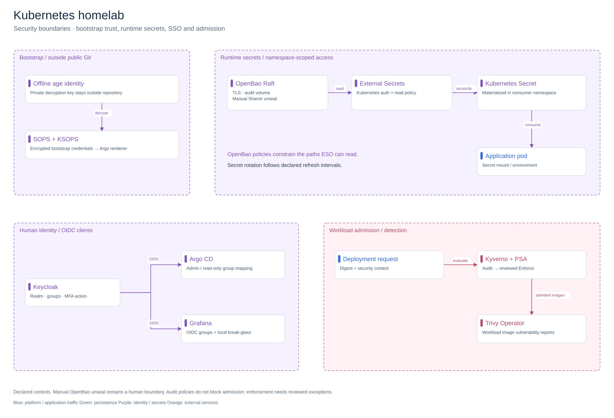
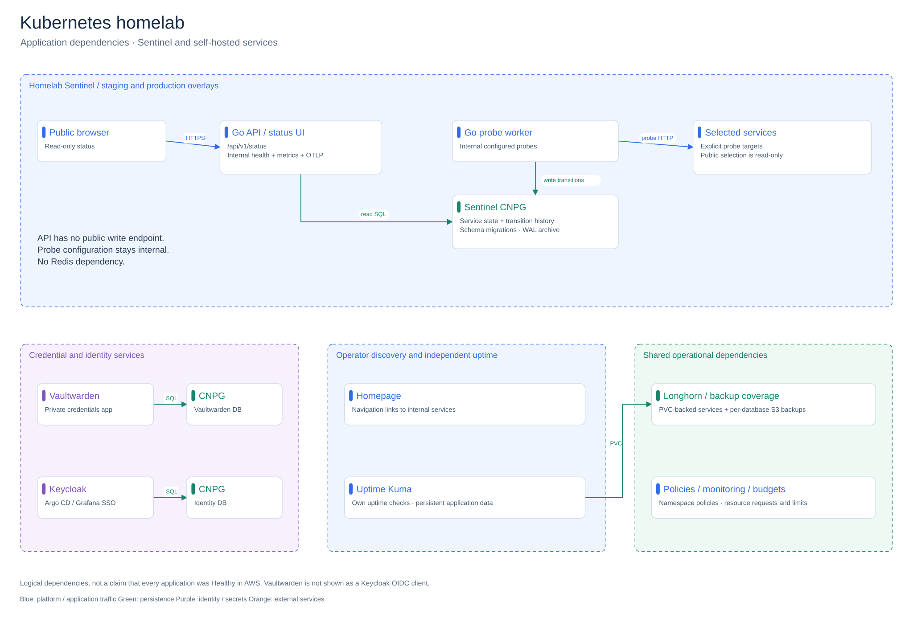

# Kubernetes homelab

Editable architecture diagrams, organized by the questions they answer.
Boundaries indicate deployment or trust scope; arrows name actual relationships.
These drawings are not screenshots or proof of successful deployment. See the
[real runtime captures](../evidence.md) and [validation ledger](../../PROGRESS.md).

## Editing

Download an `.excalidraw` file and open it in [Excalidraw](https://excalidraw.com).
Shapes, text and connectors are editable. SVG previews work directly in GitHub.
Colors separate platform traffic, persistence, identity, and external services.

## Cluster topology · service placement and dependencies

[Excalidraw source](01-platform.excalidraw) · [Full-size diagram](01-platform.svg)

Target LAN topology. Logical service placement, not pod-to-node scheduling. AWS evidence does not verify LAN ARP / L2.

Sources: [architecture.md](../architecture.md) · [status.md](../status.md).

## AWS deployment · actual validation infrastructure

[Excalidraw source](02-aws-validation.excalidraw) · [Full-size diagram](02-aws-validation.svg)

Historical deployment in eu-west-1a. Self-managed k3s, not EKS; one AZ is not multi-AZ availability. Temporary resources are retired after tests.

Sources: [main.tf](../../infra/tofu/aws-validation/main.tf) · [operate-aws-validation-environment.md](../runbooks/operate-aws-validation-environment.md).

## Network boundaries · public ingress, private administration and pod encryption

[Excalidraw source](03-network-access.excalidraw) · [Full-size diagram](03-network-access.svg)

Target routing. WARP administration and Cilium WireGuard are distinct. Argo CD administration used local port-forward during validation.

Sources: [public-surface.md](../security/public-surface.md) · [gateways](../../platform/gateways) · [cilium](../../platform/cilium).

## Delivery graph · build, sign, promote and reconcile

[Excalidraw source](04-delivery.excalidraw) · [Full-size diagram](04-delivery.svg)

Declared pipeline, not proof of every job passing. GitLab is deployment authority; GitHub package publishing is a separate path.

Sources: [.gitlab-ci.yml](../../.gitlab-ci.yml) · [publish-ghcr-packages.yaml](../../.github/workflows/publish-ghcr-packages.yaml) · [argocd](../../platform/argocd).

## Storage topology · replicas, PostgreSQL backups and independent recovery paths

[Excalidraw source](05-data-recovery.excalidraw) · [Full-size diagram](05-data-recovery.svg)

Longhorn, CNPG, and Velero restore drills are tested and fully validated with verified recovery metrics.

Sources: [longhorn](../../platform/longhorn) · [cloudnative-pg](../../platform/cloudnative-pg) · [velero](../../platform/velero) · [README.md](../dr/README.md).

## Telemetry graph · where metrics, logs and traces go

[Excalidraw source](06-observability.excalidraw) · [Full-size diagram](06-observability.svg)

Grafana is private. Dashboard screenshots are real historical AWS captures; webhook delivery and seven-day growth observation remain unverified.

Sources: [observability](../../observability) · [evidence.md](../evidence.md) · [respond-to-platform-alerts.md](../runbooks/respond-to-platform-alerts.md).

## Security boundaries · bootstrap trust, runtime secrets, SSO and admission

[Excalidraw source](07-security-identity.excalidraw) · [Full-size diagram](07-security-identity.svg)

Declared controls. Manual OpenBao unseal remains a human boundary. Audit policies do not block admission; enforcement needs reviewed exceptions.

Sources: [openbao](../../platform/openbao) · [keycloak](../../platform/keycloak) · [policies](../../policies) · [threat-model.md](../security/threat-model.md).

## Application dependencies · Sentinel and self-hosted services

[Excalidraw source](08-application-estate.excalidraw) · [Full-size diagram](08-application-estate.svg)

Logical dependencies, not a claim that every application was Healthy in AWS. Vaultwarden is not shown as a Keycloak OIDC client.

Sources: [apps](../../apps) · [keycloak](../../platform/keycloak) · [capacity.md](../capacity.md).

## Maintenance

Edit [the generator](../../scripts/build-kubernetes-diagrams.mjs), then run
`node scripts/build-kubernetes-diagrams.mjs`. No external dependencies are required.
Generation is deterministic. Regeneration overwrites manual Excalidraw edits; copy
content changes back to the generator first.
