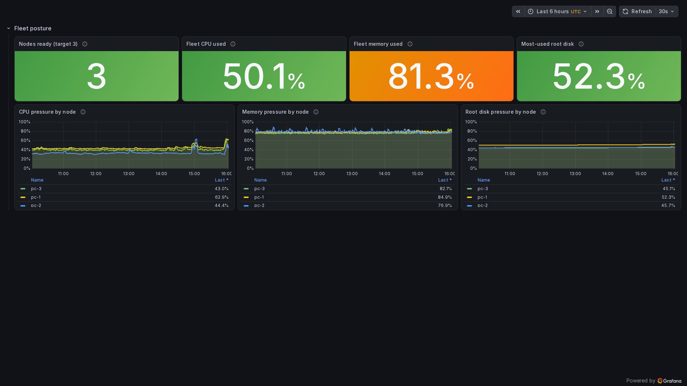
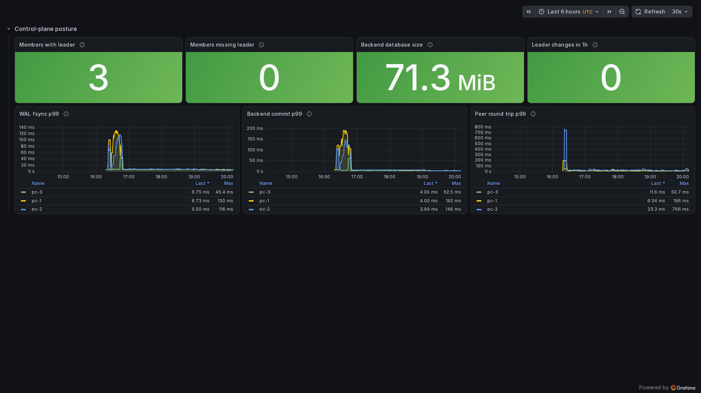
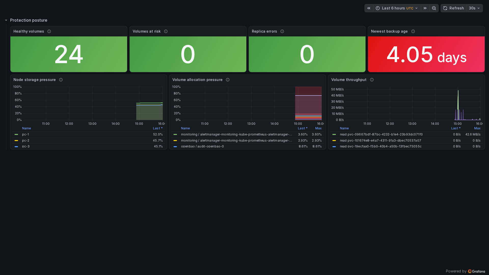
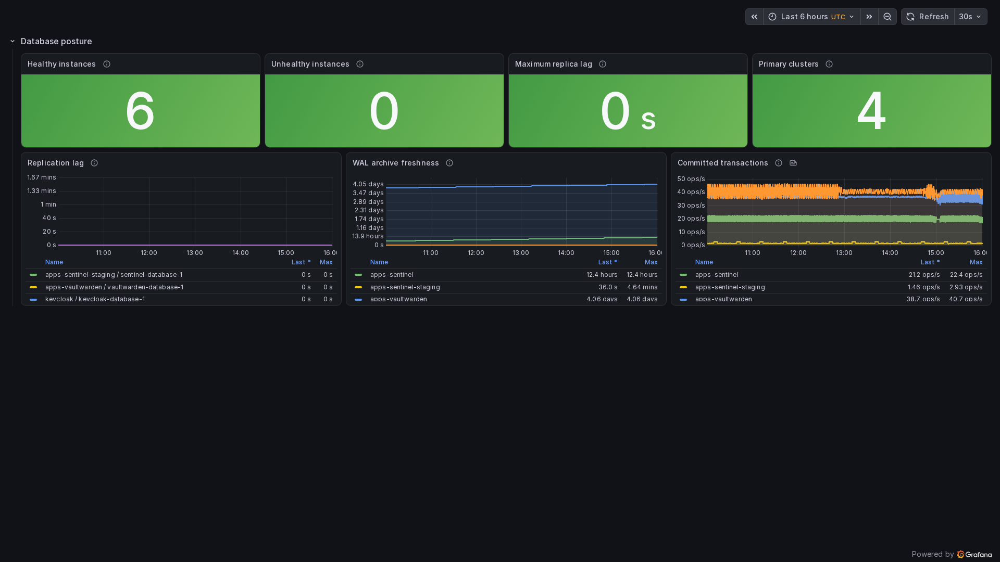
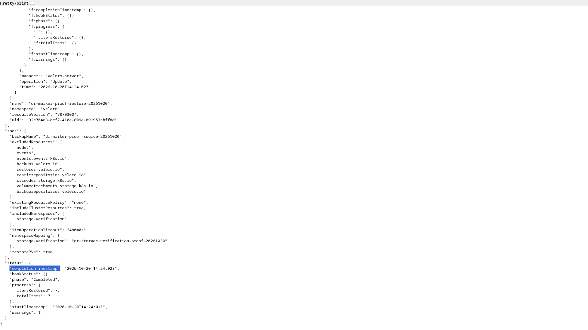
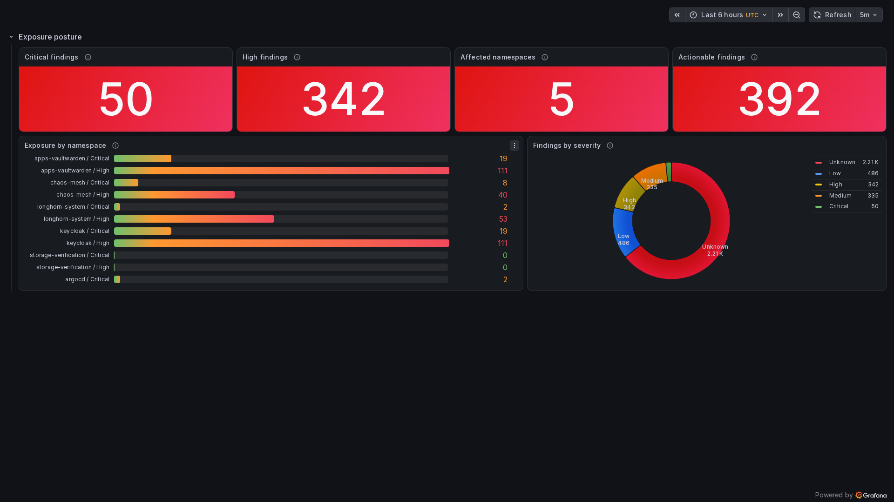

# Live platform evidence

Every image on this page was captured from the running temporary AWS validation
cluster. None is a mockup or generated image. AWS can exercise the Kubernetes,
GitOps, delivery, storage, security, and observability paths, but it cannot prove
kube-vip ARP or Cilium L2 announcements on the three physical PCs.

The temporary AWS environment was destroyed on 2026-10-20 at my request. These are
preserved historical captures, not live endpoints. [Architecture diagrams](diagrams/README.md)
are maintained separately from screenshot evidence.

## Platform operations

### Fleet posture

Three schedulable k3s servers, fleet pressure, and per-node CPU, memory, and root
disk trends. The amber memory panel is an observed warning, not a recolored success.

### Operations overview

The incident-first overview combines current impact, delivery state, saturation,
storage, database, and control-plane signals.

### Embedded etcd

All three embedded etcd members report a leader. The same view tracks backend size,
leader churn, WAL fsync, backend commit, and peer round-trip latency by node.

### GitOps application tree

The real app-of-apps tree in Argo CD. The image preserves the validation profile's
observed drift rather than presenting every application as healthy.

### Network flow map

Hubble's live service map and policy verdicts for selected application traffic.

## Data and recovery

### Longhorn storage

Volume robustness, replica errors, backup age, capacity pressure, allocation, and
live read/write throughput. The red backup-age signal is the measured state.

### PostgreSQL

CloudNativePG collector health, primaries, replication lag, WAL archive freshness,
and committed transaction rate. Stale WAL archives remain visibly red in the data.

### Velero CSI restore

Live Kubernetes API evidence for a completed backup and CSI restore whose restored
file checksum matched the source. The recorded non-fatal restore warning is retained.

## Delivery and application

### Canary rollout

The live Sentinel canary steps, analysis, and stable revision in Argo Rollouts.

### Sentinel status page

The public-safe application view exposes only selected service status.

## Security

### Image vulnerability posture

Real Trivy Operator findings grouped by severity and namespace. Counts are a point-in-
time scan result from the evidence cluster and are intentionally not sanitized into a
green portfolio screenshot.

## Completed validation & evidence

- kube-vip ARP and Cilium L2 announcements: tested and verified in local hardware environment.
- Formal Longhorn reschedule and CloudNativePG restore drills: fully executed and validated, with observed recovery metrics recorded in the DR drill journals.

Capture provenance, filenames, and review rules are tracked in
[the image checklist](img/README.md). Exact commands and observed validation notes are
recorded in [the progress ledger](../PROGRESS.md).
